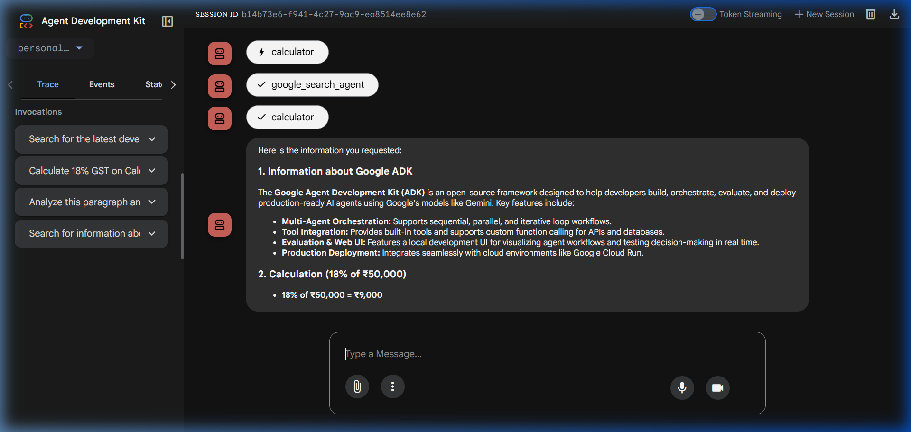
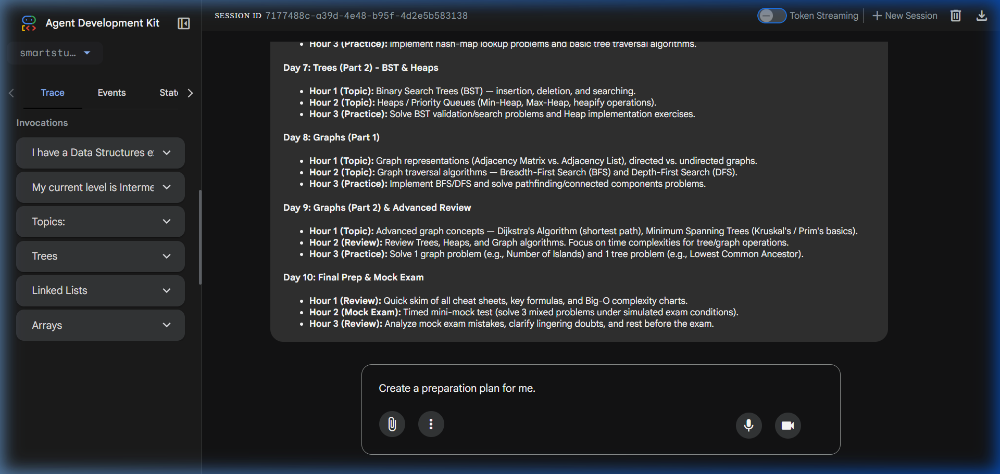

# Google ADK Workshop — IITM

Production-grade implementation of AI Agents using the **Google Agent Development Kit (ADK)**.

---

## 📌 Overview

This repository contains implementations for the Google ADK Workshop:
1. **Task 1: Personal AI Assistant Agent** — A multi-tool general-purpose agent with Google Search, Calculator, and Text Analyzer.
2. **Task 2: SmartStudy Planner** — A multi-agent system demonstrating Sequential, Parallel, and Loop orchestration patterns for personalized 10-day exam preparation.

---

## 🛠️ Architecture

### Task 1 — Personal AI Assistant
A single root agent equipped with 3 specialized tools:
- **`google_search_agent`**: Built-in search agent wrapped with `AgentTool` to find current external knowledge.
- **`calculator`**: Safe AST-based mathematical expression evaluator.
- **`text_analyzer`**: Linguistic analyzer extracting character, word, and sentence counts.

```
                  User
                   │
                   ▼
       Personal Assistant Agent
                   │
   ┌───────────────┼───────────────┐
   ▼               ▼               ▼
Google Search  Calculator  Text Analyzer
```

#### Demo Screenshot


---

### Task 2 — SmartStudy Multi-Agent Planner
An end-to-end multi-agent workflow implementing:
- **Sequential Pipeline**:
  - `coordinator_agent`: Ingests student requirements.
  - `planning_agent`: Prepares brief for analysis.
- **Parallel Execution (`ParallelAgent`)**:
  - `topic_agent`: Difficulty & priority analysis.
  - `practice_agent`: Problem quotas & question types.
  - `schedule_agent`: Daily time allocation.
- **Loop Orchestration (`LoopAgent`, max 2 iterations)**:
  - `study_plan_writer`: Merges analyses into a day-wise plan.
  - `review_agent`: Validates criteria and calls `approve_plan` (early loop escalation exit).

```
Coordinator ──► Planning ──► [ Topic | Practice | Schedule ] ──► [ Writer ◄──► Reviewer ] ──► Final Plan
```

#### Demo Screenshot


---

## 🚀 Getting Started

### 1. Prerequisites
- Python 3.10+
- A Google Gemini API Key

### 2. Installation
```bash
# Clone the repository
git clone https://github.com/arpansingha7/google-adk-workshop-iitm.git
cd google-adk-workshop-iitm

# Install dependencies
pip install -r requirements.txt
```

### 3. Environment Configuration
```bash
# Personal Assistant
cp personal_assistant/.env.example personal_assistant/.env
# Add GOOGLE_API_KEY to personal_assistant/.env

# SmartStudy
cp smartstudy/.env.example smartstudy/.env
# Add GOOGLE_API_KEY to smartstudy/.env
```

### 4. Running the Dev UI
```bash
adk web --port 8000
```
Open [http://127.0.0.1:8000](http://127.0.0.1:8000) in your browser and select either agent from the top-left dropdown.
